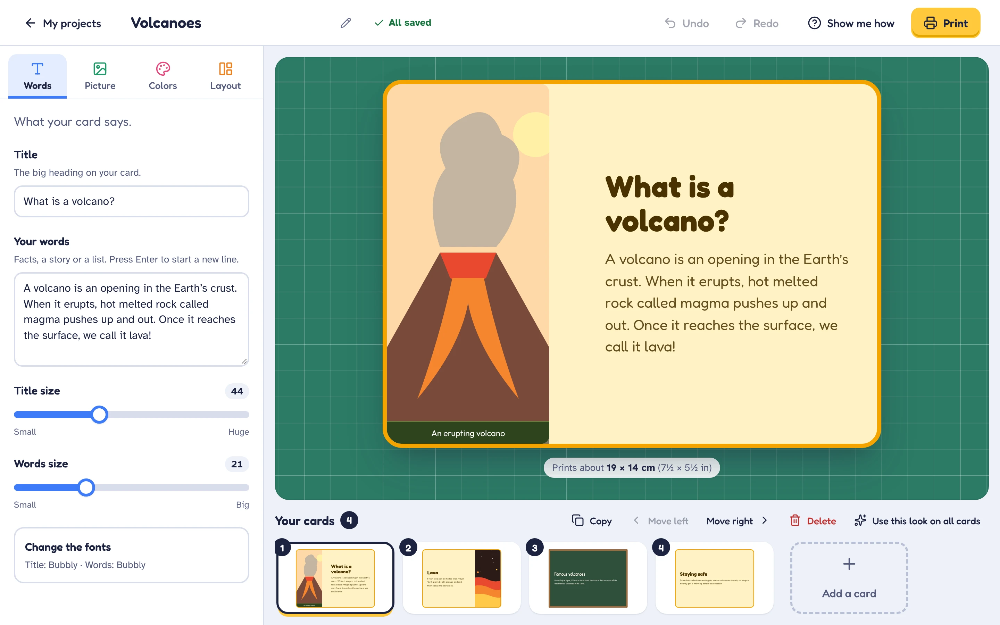
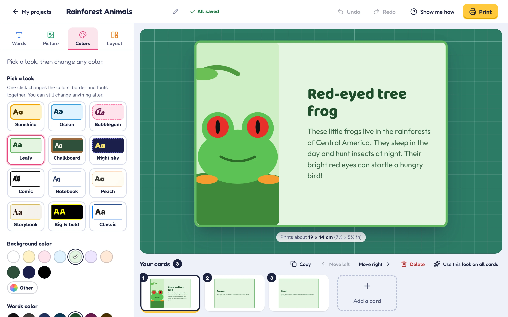
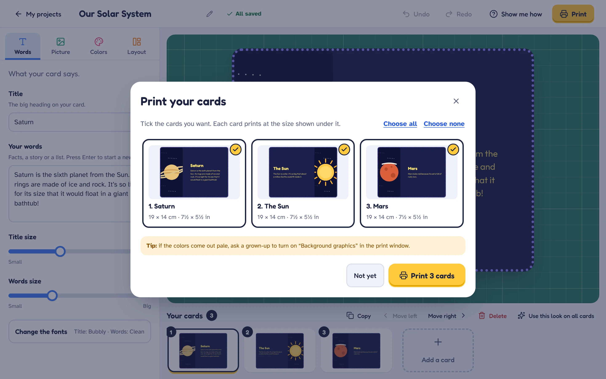
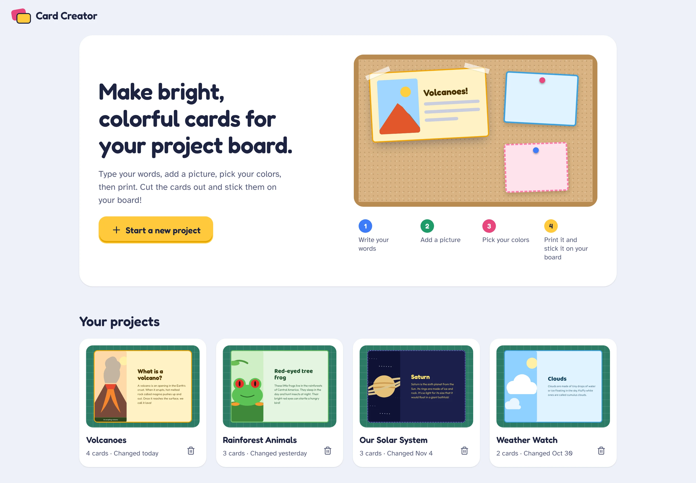

# Card Creator

**Bright, colorful cards for school project boards, made by kids, ready to print.**

Card Creator helps kids make cards for a school project board. Type a title and a few facts, add a picture, pick a
look, then print the cards, cut them out and stick them on the board. It's friendlier than pasting plain printouts,
and simple enough to use without a grown-up hovering nearby.

[](https://github.com/gitosaurusrex/card-creator/actions/workflows/ci.yml)
[](LICENSE)


[](https://vercel.com/new/clone?repository-url=https%3A%2F%2Fgithub.com%2Fgitosaurusrex%2Fcard-creator)



## Why kids (and grown-ups) like it

- **Made for kids.** Big buttons, plain words and a one-line hint on every control. A short animated demo shows the
  idea, and **Show me how** walks through the editor step by step.
- **One click to look great.** Twelve ready-made looks, from Sunshine and Ocean to Chalkboard and Night sky. Then
  change any color, border, corner or font.
- **What you see is what prints.** The preview is the printout, down to where each line of text wraps, and every card
  shows its size on paper (for example 19 × 14 cm).
- **You can't break anything.** Every change saves by itself, and Undo goes back step by step.
- **Pictures that fit.** Add a photo or drawing, choose which side it goes on, add a label, and pick which part of it
  shows.
- **Safe with pictures and accounts.** Each child's projects belong to their own account. Uploads are checked to be
  real images before they're stored.

<table>
  <tr>
    <td width="50%"></td>
    <td width="50%"></td>
  </tr>
  <tr>
    <td colspan="2"></td>
  </tr>
</table>

## What you can do

- **Write**: a title and your words, with a choice of fun fonts and sizes.
- **Add a picture** from your computer (or a link), choose which side it goes
  on, add a label, and pick which part of the picture shows.
- **Pick a look** with one click (Sunshine, Ocean, Chalkboard and more), then
  change any color, border or corner you like.
- **Arrange**: wide or tall cards, how tall each card is, where the words sit
  and how much space goes around them.
- **Keep going**: copy, reorder and delete cards, undo and redo anything, and
  use one card's look on all the others.
- **Print**: choose which cards to print. The preview shows each card exactly
  as it will print, with its size on paper (for example 19 × 14 cm).
- **Get help**: a short animated demo shows the idea, and "Show me how" opens a
  guided tour of the editor. Every control has a one-line hint.

Projects save automatically to your account, with a copy kept in the browser in
case the internet drops out.

## Running it yourself

### On Vercel
Use the **Deploy with Vercel** button above. You'll need a Clerk application
(for sign-in) and a Postgres database. Set these environment variables:

| Variable | What it's for |
| --- | --- |
| `VITE_CLERK_PUBLISHABLE_KEY` | Clerk publishable key, used by the browser |
| `CLERK_SECRET_KEY` | Clerk secret key, used by the API |
| `POSTGRES_URL` | Postgres connection string |
| `INIT_DB_SECRET` | Only while setting up the database (see below) |

### Database setup
The tables are created by `/api/init-db`, which is switched off unless the
`INIT_DB_SECRET` environment variable is set. Set it, redeploy, then run:

```bash
curl -X POST -H "Authorization: Bearer $INIT_DB_SECRET" https://<your-deployment>/api/init-db
```

It's safe to run again later. Afterwards, delete the variable and redeploy to
switch the endpoint off.

### On your computer
```bash
git clone https://github.com/gitosaurusrex/card-creator.git
cd card-creator
npm ci
npm run dev
```

## Tests

```bash
npm run lint
npm run test:api   # API handlers, with Postgres and Clerk mocked
npm run test:e2e   # Playwright, in the browser against a mocked API
```

The end-to-end tests start Vite with `--mode e2e`, which swaps Clerk for a local
stub (`tests/e2e/clerk-stub.jsx`), so no Clerk account or database is needed.
Run `npx playwright install chromium` once before the first run. CI runs all of
these on every pull request.

The screenshots in this README come from `node scripts/screenshots.mjs`, which
uses the same test mode with made-up projects.

## Working on it

[AGENTS.md](AGENTS.md) explains how the code fits together, the rules that keep
printing and saved projects working, and the list of outstanding work.

## Under the hood (TL;DR)

- React 19 and Vite 7, plain CSS with design tokens, Lucide icons. Clerk for sign-in. Vercel Functions (Node 24) with
  Postgres for saving projects and pictures.
- One component draws every card, in the editor, in thumbnails and on paper, so they always match. Card styles live
  in `src/styles/card.css`, separate from the app's own styles.
- A wide card is **718 px** across: the printable width of an A4 page with 10 mm margins. That's why screen and paper
  wrap text identically.
- Edits save 1.5 seconds after you stop, and straight away when you leave. A copy goes into the browser first, so
  nothing is lost if the internet drops out, and saves never overtake each other.
- Uploads are checked by their actual bytes (PNG, JPEG, GIF or WebP), never by what the browser claims.

For the full tour (card fields, the renderer, printing, undo, saving and syncing, accounts, the API, pictures, the
database and a code map) read **[docs/technical.md](docs/technical.md)**.

## License

[MIT](LICENSE). Use it, change it, run your own copy, share it. Just keep the copyright notice.

---
Made by [gitosaurusrex](https://github.com/gitosaurusrex).
